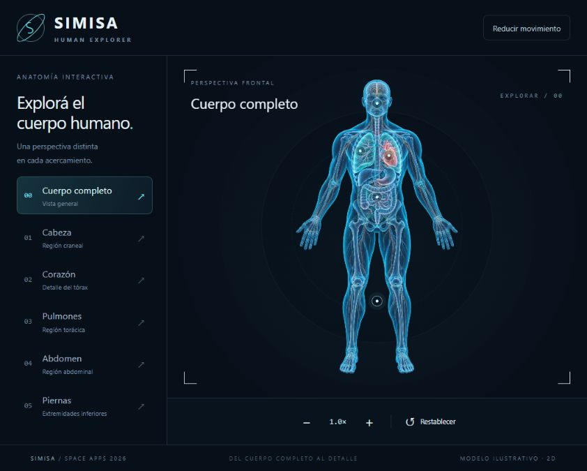

# SIMISA — Space Health Monitor

[](https://www.spaceappschallenge.org/2026/)
[](#current-status)
[](LICENSE)

SIMISA is an interactive health self-monitoring concept for astronauts on long-duration missions. The project explores how an astronaut could navigate through the human body, understand selected health indicators, and receive contextual guidance when immediate support from Earth is delayed.

This repository is being developed during the **NASA Space Apps Challenge 2026** for the challenge **Create Health Monitoring Software for Astronauts on Space Missions**.

> **Prototype notice:** SIMISA currently uses conceptual anatomy artwork and simulated interactions. It is not a medical device, does not provide a diagnosis, and has not been certified or endorsed by NASA.



## Current status

The reference-based dashboard is now available at the repository root (`index.html`). It includes animated body navigation, demo metric panels, a daily check-in saved in this browser, simulated device toggles, charts, and reduced-motion controls. Run `python -m http.server 4174 --bind 127.0.0.1` from the repository root and open http://127.0.0.1:4174. See [the dashboard implementation notes](docs/simisa/07-pantalla-principal.md). Dashboard content is currently in Spanish to follow the team's reference; English localization remains pending.

The original body-only motion study remains available in `prototipo-cuerpo/`:

- Full-body anatomical overview.
- Animated transitions between selected regions.
- Navigation to the head, heart, lungs, abdomen, and legs for motion studies.
- Drag, wheel zoom, keyboard navigation, and reset controls.
- Reduced-motion support.
- No health readings or clinical logic yet.

The functional health prototype is intentionally narrower: body regions will only become health modules when they map clearly to metrics available in the system. The first proposed modules are cardiovascular and respiration/oxygenation.

## Run the body explorer

The current prototype has no dependencies or build step.

```powershell
cd prototipo-cuerpo
python -m http.server 4173 --bind 127.0.0.1
```

Then open [http://127.0.0.1:4173](http://127.0.0.1:4173).

You can also use another static HTTP server. The implementation is plain HTML, CSS, and JavaScript so the team can review the interaction immediately. React, Vite, and Motion remain the recommended stack for the complete application.

## Project structure

```text
.
├── prototipo-cuerpo/        # Working interactive body explorer
│   ├── assets/              # Concept artwork and provenance notes
│   ├── app.js               # Camera, zoom, drag, and region navigation
│   ├── index.html           # Prototype structure
│   └── styles.css           # Visual system and responsive behavior
├── docs/simisa/             # Product, design, architecture, and demo plans
├── Challenge summary.txt    # Local challenge summary used by the team
└── SIMISA – Plan...md       # Earlier planning document kept for context
```

Start with [the documentation index](docs/simisa/README.md) and the [30-hour prototype plan](docs/simisa/01-plan-prototipo-30h.md).

## Design direction

The body is the main navigation surface. The astronaut starts from a full-body view and moves toward a prepared view of the relevant system. Each anatomical destination must be justified by an available metric:

| Proposed module | Metrics | Visual focus |
| --- | --- | --- |
| Cardiovascular | Heart rate; blood pressure if included | Heart and thoracic context |
| Respiration and oxygenation | Respiratory rate and SpO₂ | Thorax and lungs |
| Well-being | Sleep, mood, and self-reported stress | Separate check-in; no anatomical diagnosis |
| General indicators | Temperature and body mass, if included | Full-body context |

The detailed rationale is documented in [Design and animations](docs/simisa/02-diseno-y-animaciones.md).

## Planned technology

- **React + Vite** for the application shell.
- **Motion** for body navigation and transitions.
- **SVG and layered raster illustrations** for interactive anatomy.
- **Recharts** if charts are included in the functional prototype.
- Browser-local, reproducible demo scenarios without a backend.

See [Technology and architecture](docs/simisa/03-tecnologia-y-arquitectura.md) for the trade-offs and alternatives.

## NASA resources and future standards work

SIMISA uses NASA Human Research Program material to frame the hazards of long-duration human spaceflight. The team is also researching NASA-STD-3001 as a future requirements source. The current prototype does **not** claim compliance with NASA standards. Applicable requirements, traceability, verification methods, and evidence would need to be established for a real mission system.

See [NASA integration and sources](docs/simisa/04-integracion-nasa-y-fuentes.md).

## Language

The application and final submission are planned in English. Internal planning documents are currently in Spanish to support the team during the hackathon.

## AI and asset disclosure

AI tools assisted with planning, source drafting, code development, and the conceptual anatomical illustration. The generated artwork is documented in [its provenance file](prototipo-cuerpo/assets/PROCEDENCIA.md). The anatomy has not been medically validated and must be reviewed before educational or clinical use.

Reference screenshots shared privately by the team are intentionally excluded from version control.

## Contributing

Read [CONTRIBUTING.md](CONTRIBUTING.md) before opening a pull request. Please keep changes scoped, document external assets, and distinguish implemented, simulated, and future capabilities.

## License

Source code and original documentation are released under the [MIT License](LICENSE). External resources retain their respective terms. See [NOTICE.md](NOTICE.md) for project and asset notices.

---

## Resumen en español

SIMISA es un prototipo interactivo para explorar cómo un astronauta podría consultar su salud durante una misión de larga duración. La primera muestra implementa únicamente el gráfico corporal, los acercamientos y el desplazamiento entre regiones. Los datos de salud y las integraciones con dispositivos se incorporarán después, usando solamente regiones que tengan una relación clara con las métricas disponibles.

El proyecto es conceptual, utiliza datos simulados y no constituye un dispositivo médico ni una solución certificada por NASA.
