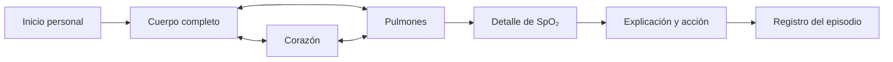

# SIMISA — Diseño de interfaz y recorrido animado

Fecha: 14 de noviembre de 2026. Especificación propuesta para el prototipo de muestra.

## 1. Interpretación de las referencias

Las dos imágenes muestran una aplicación personal de salud con estética espacial: fondo azul oscuro, iluminación celeste, navegación lateral, grandes ilustraciones anatómicas y tarjetas de indicadores.

La referencia A reúne 15 pantallas y expresa la amplitud del producto futuro. La referencia B desarrolla Salud Corporal con cuerpo completo, sistema cardiovascular, sistema respiratorio, huesos e información adicional. Esta segunda imagen define mejor la experiencia central del prototipo.

| Conservar | Ajustar al construir |
| --- | --- |
| Anatomía como punto de entrada | Hacer las zonas seleccionables y acompañarlas con botones |
| Fondo oscuro y acento celeste | Reducir brillos permanentes y fondos detrás del texto |
| Tarjetas grandes con números claros | Dar espacio suficiente a unidades, fecha y calidad |
| Menú persistente | Mostrar solamente secciones implementadas en el recorrido |
| Órganos ilustrados | Usar recursos consistentes en estilo, encuadre y resolución |
| Tendencias y orientación contextual | Explicar origen y límites de los datos simulados |

Las referencias expresan intención visual. Sus cifras, nombres de sensores, mensajes médicos, porcentajes de salud y textos de ejemplo no deben copiarse como información validada.

## 2. Principio de navegación

El usuario explora un mismo cuerpo que permanece reconocible mientras cambia el foco. Al seleccionar una región, la vista se acerca, destaca el órgano y actualiza el panel informativo. Los datos mantienen una ubicación estable al costado.

No se plantea una cámara libre ni un recorrido por el interior de vasos u órganos. Se propone una navegación guiada entre posiciones preparadas, con sensación de profundidad y continuidad.



El cambio de sección lo decide la persona. Una alerta puede señalar la región y ofrecer un botón para abrirla; no debe arrastrar la vista automáticamente mientras el usuario lee otra información.

## 3. Composición de la interfaz

### Pantalla de referencia

- Diseñar primero para una laptop de 1440 × 900 y verificar también 1366 × 768.
- Menú lateral aproximado de 200–220 px.
- Encabezado con nombre ficticio, contexto de misión y etiqueta Demo.
- Zona central amplia para el cuerpo, aproximadamente 55 % del espacio útil restante.
- Zona lateral de información, aproximadamente 45 %, con valores y acciones.
- Separación de 16–24 px entre bloques; priorizar una lectura cómoda sobre estas cifras iniciales.

Distribución conceptual:

```text
┌────────────┬───────────────────────────────────────────────────┐
│ SIMISA     │ Ana Torres · Mission scenario · DEMO              │
│            ├───────────────────────────┬───────────────────────┤
│ Overview   │                           │ Región seleccionada   │
│ Body       │ Cuerpo / órgano           │ Valores + unidades    │
│ Check-in   │                           │ Calidad y antigüedad  │
│ Devices    │ Zonas interactivas        │ Tendencia             │
│            │                           │ Explicación + acción  │
│            │ [Full body]               │                       │
├────────────┴───────────────────────────┴───────────────────────┤
│ Enlace simulado con Tierra · Avisos · Controles de demo         │
└────────────────────────────────────────────────────────────────┘
```

En tablet se conserva el recorrido con menú compacto. En móvil, apilar cuerpo y detalle, permitir desplazamiento y mantener un botón de retorno visible. No prometer la misma composición de laptop en todos los tamaños; sí evitar controles fuera de pantalla.

### Navegación principal

| Etiqueta propuesta | Función |
| --- | --- |
| Overview | Resumen personal y entrada a la exploración |
| Body Explorer | Navegación corporal y detalles de sistemas |
| Daily Check-in | Registro breve de sueño, ánimo y estrés |
| Devices | Estado de las fuentes simuladas |

Alertas, fuentes y comunicación pueden abrir paneles desde botones del encabezado o de una tarjeta. No incluir botones que aparenten funcionar pero no tengan un resultado definido.

## 4. Especificación de las experiencias

### Inicio personal

Mostrar nombre ficticio, resumen de los indicadores disponibles, última actualización y un botón destacado Explore my health. Evitar afirmar que toda la salud está en estado óptimo a partir de dos o tres mediciones.

Una tarjeta breve de rutina puede mostrar si el check-in fue completado. La vista comienza sin login ni selección obligatoria de rol.

### Cuerpo completo

- Silueta anatómica con corazón y pulmones identificables.
- Botones equivalentes Heart, Lungs y Full body para facilitar selección precisa.
- Al enfocar una región por teclado o puntero, mostrar nombre y contorno.
- Diferenciar selección de estado de salud: el contorno celeste indica dónde se está navegando; la etiqueta de estado comunica la situación.
- Las regiones futuras pueden omitirse o aparecer como información conceptual sin controles engañosos.

### Detalle cardiovascular

Ilustración del corazón, frecuencia cardíaca simulada, tendencia y explicación breve. La presión arterial es opcional. No agregar una onda de electrocardiograma decorativa que parezca una señal adquirida.

### Detalle respiratorio

Ilustración de pulmones, SpO₂, frecuencia respiratoria, gráfica del indicador seleccionado y estado del sensor. Desde aquí se desarrolla el episodio de demo. El color de los pulmones representa el indicador asociado para navegación, no un diagnóstico del órgano.

### Tarjeta de indicador

Orden de lectura propuesto:

1. Nombre del indicador y valor con unidad.
2. Estado explicado con texto e ícono.
3. Momento de medición, fuente simulada y calidad.
4. Tendencia con escala y período explícitos.
5. What does this mean? con explicación y fuente.
6. Acción disponible, si corresponde al escenario.

Una misma plantilla debe servir para FC, SpO₂ y frecuencia respiratoria.

### Panel de alerta

Contiene qué cambió, en qué momento del escenario, qué dato lo sustenta, calidad de la lectura y orientación aprobada. Acciones diferenciadas: Acknowledge, Record action y View sensor. Reconocer no resuelve el episodio.

El cambio a recuperación proviene de nuevas lecturas del escenario, no de pulsar Entendido. La interfaz debe permitir ver que una alerta reconocida continúa activa.

### Dispositivos

Cada tarjeta identifica una fuente simulada y muestra conexión, última lectura y calidad. Con conexión perdida: valor actual ausente, última medición conservada con fecha y tendencia interrumpida. Mantener visibles los antecedentes del episodio si existían.

### Check-in

Tres campos breves: sueño en horas, ánimo y estrés. Botón Save check-in y confirmación visible. Al reabrir debe aparecer el dato guardado. No convertir respuestas en diagnósticos ni exhibir información personal real en esta demo pública.

## 5. Sistema visual propuesto

Estos valores son puntos de partida de diseño, no requisitos de NASA. Ajustarlos al revisar la pantalla real.

| Token | Valor inicial | Uso |
| --- | --- | --- |
| Fondo | `#06111F` | Superficie principal |
| Panel | `#0C2038` | Tarjetas y áreas de detalle |
| Panel elevado | `#12304B` | Paneles y selección secundaria |
| Borde | `#28475F` | Separación discreta |
| Acento | `#35C8FF` | Navegación, selección y acción principal |
| Texto principal | `#F1F6FC` | Títulos y valores |
| Texto secundario | `#B5C8DB` | Ayudas y metadatos |
| Dentro de referencia | `#43D7A1` | Estado acompañado de texto |
| Atención | `#FFC66D` | Lectura que requiere revisión |
| Alerta | `#FF7185` | Episodio señalado |
| Sin datos | `#A0ACBB` | Falta de medición actual |

- Usar una tipografía sans serif legible; fuente de sistema si no hay tiempo para empaquetar otra.
- Texto principal de 16 px como objetivo; metadatos de 14 px o más si el espacio lo permite.
- Valores destacados entre 28 y 40 px; tamaños estables para que no salte la composición.
- Números con ancho tabular y unidades visibles.
- Esquinas de 12–16 px y una única intensidad de sombra por nivel.
- Fondo espacial tenue solo en zonas ilustrativas; evitar estrellas detrás de textos pequeños.
- Verificar el contraste de cada combinación utilizada, especialmente texto sobre botones celestes.
- Los colores anatómicos pueden formar parte de la ilustración; la leyenda de estado siempre debe ser explícita.

## 6. Lenguaje de movimiento

La animación tiene tres funciones: orientar la navegación, ilustrar actividad y comunicar un cambio. La primera es prioritaria.

| Interacción | Movimiento propuesto | Duración inicial |
| --- | --- | --- |
| Entrar a Body Explorer | Aparición gradual del cuerpo | 200–300 ms |
| Enfocar una región | Contorno y etiqueta | 120–180 ms |
| Seleccionar corazón o pulmones | Acercamiento y desplazamiento hacia la región | 450–650 ms |
| Cambiar entre corazón y pulmones | Reencuadre corto y cambio de énfasis | 350–550 ms |
| Mostrar detalle | Fundido y desplazamiento muy pequeño del contenido | 180–250 ms, solapado con el reencuadre |
| Volver a cuerpo completo | Alejamiento hacia el encuadre inicial | 450–650 ms |
| Abrir panel de alerta | Entrada breve desde un lateral | 180–250 ms |
| Señalar un nuevo aviso | Un énfasis visual breve; luego estado estable | Una vez por episodio |

Las duraciones son criterios de diseño para probar. No deben sumarse en largas secuencias obligatorias; cuerpo y detalle pueden animarse al mismo tiempo.

### Acercamiento al corazón

1. El usuario selecciona Heart o la zona del pecho.
2. El cuerpo se desplaza y amplía hasta el encuadre previsto.
3. Las regiones no seleccionadas pierden intensidad sin desaparecer del todo.
4. Una ilustración de mayor detalle del corazón aparece en el lugar correcto.
5. La información cardiovascular queda visible en la columna lateral.

### Del corazón a los pulmones

Como ambas regiones están cerca, el desplazamiento puede ser pequeño. La diferencia perceptiva viene del énfasis, el órgano detallado y los datos. No forzar un viaje enorme para una distancia anatómica corta.

### Movimiento ilustrativo de órganos

- Latido suave del corazón y expansión ligera de los pulmones son opcionales.
- Si no derivan de la lectura mostrada, identificarlos como ilustración y no como reproducción del ritmo medido.
- Evitar animaciones que parezcan confirmar una función fisiológica cuando falta información.
- Pausar movimiento decorativo al ocultar la pestaña o salir de la región.
- No usar temblores, destellos intensos, giros de cámara ni recorridos automáticos continuos.

## 7. Interrupciones, orientación y accesibilidad

- Si la persona selecciona otra región durante una transición, la última selección prevalece. La escena debe llegar al nuevo destino sin encadenar movimientos antiguos.
- Los datos y el título deben corresponder siempre a la selección vigente, también durante el fundido.
- Mantener Full body visible en la vista ampliada. Un minimapa es P1 si aporta orientación.
- Las regiones deben poder abrirse por una lista de botones; hover no es la única forma de descubrirlas.
- Mantener foco visible y moverlo de forma predecible al abrir o cerrar un panel. El foco no sigue cada actualización numérica.
- Objetivo de diseño: controles táctiles de aproximadamente 44 × 44 px o mayores cuando haya espacio.
- Todo estado usa texto e ícono además del color.
- Ofrecer Reduce motion y respetar la preferencia del sistema. Sustituir acercamientos por fundidos breves y desactivar movimientos decorativos.

La preferencia de movimiento reducido puede detectarse con CSS y gestionarse con Motion. [MDN: prefers-reduced-motion](https://developer.mozilla.org/en-US/docs/Web/CSS/Reference/At-rules/@media/prefers-reduced-motion), [Motion: accesibilidad](https://motion.dev/docs/react-accessibility).

## 8. Ilustraciones y recursos necesarios

| Recurso | Requisito de uso |
| --- | --- |
| Cuerpo completo | Fondo transparente, pose frontal y proporciones estables |
| Corazón | Ilustración de detalle compatible con el estilo del cuerpo |
| Pulmones | Ilustración de detalle compatible con el mismo encuadre |
| Zonas de selección | SVG o geometría simple alineada con el cuerpo |
| Íconos | Familia consistente, sin mezclar muchos estilos |
| Fondo espacial | Discreto, comprimido y prescindible para leer la interfaz |

Separar ilustración y controles: un PNG puede ser el fondo anatómico, pero nombres, cifras y botones deben ser elementos reales de la interfaz. No convertir el collage de referencia en una captura gigante con enlaces encima.

Si se usan imágenes rasterizadas, exportarlas con resolución suficiente para el mayor acercamiento previsto. Preparar la ilustración de detalle por separado si ampliar el cuerpo produce pixelación. Mantener el mismo punto de anclaje durante el cambio de capa.

Registrar autor, origen, licencia y modificaciones. Si se generan recursos con IA, revisar anatomía y documentar ese uso según las reglas que se confirmen para la entrega.

## 9. Contenido que conviene corregir de las referencias

- Reemplazar Salud óptima 94 % por un resumen limitado a indicadores disponibles, sin puntuación inventada.
- No mostrar Hidratación 96 % o Metabolismo +2 % sin método y significado definidos.
- No mezclar FC, presión y SpO₂ en un mismo eje numérico sin explicar unidades y escalas; preferir gráficas separadas.
- No presentar densidad ósea como una lectura continua de un sensor genérico.
- Mostrar estados de conexión específicos: Device connected y Earth link delayed, evitando el ambiguo Online.
- Usar fuentes NASA como evidencia y contexto; la identidad visual de SIMISA no debe sugerir que NASA certificó el prototipo.

## 10. Criterio visual de aprobación interna

En una laptop, una persona ajena al diseño puede encontrar corazón y pulmones, recorrerlos, volver al cuerpo completo y explicar qué indicador cambió. Durante ese recorrido, las ilustraciones no se pixelan de forma evidente, las tarjetas no saltan de posición y ningún efecto oculta una acción importante.

## 11. Evolución propuesta: orientación específica por región

El usuario propone utilizar imágenes en distintas orientaciones y elegir para cada sección la que permita visualizarla mejor. Esta estrategia amplía la muestra actual, que utiliza una única imagen frontal con desplazamiento y zoom. Las orientaciones adicionales todavía no están implementadas. Las vistas de la tabla siguiente son posibilidades gráficas: su inclusión depende de las métricas que las justifiquen, según la sección 12.

| Destino | Vista candidata para revisar |
| --- | --- |
| Cuerpo completo | Frontal, como referencia espacial |
| Cabeza | Frontal o lateral según la estructura que se quiera mostrar |
| Corazón | Detalle de tres cuartos con contexto del tórax |
| Pulmones | Frontal, con ambos pulmones visibles |
| Abdomen | Frontal o ligeramente oblicua, según el foco |
| Columna, si se incorpora | Vista posterior |

Secuencia propuesta: acercarse a la región sobre el cuerpo frontal, alinear el punto de interés y fundir suavemente hacia su ilustración específica. Al volver, recuperar la vista frontal antes de alejarse. El cambio de vista debe tener una etiqueta visible; evitar que el usuario confunda anterior, posterior, izquierda y derecha anatómicas.

Es una colección de vistas preparadas, no una rotación 3D libre. Mantener estilo, proporciones, iluminación y escala coherentes. Si se dispone de un modelo 3D con licencia apropiada, se pueden producir las imágenes fuera de la aplicación y entregar solamente esos renders al navegador. Si se generan ilustraciones por separado, revisar especialmente su consistencia anatómica.

Cada vista necesita su propia imagen, encuadre y zonas interactivas: no reutilizar sin cambios los puntos de la vista frontal. El fundido debe conservar un anclaje reconocible y comenzar cuando la imagen de destino esté lista. Si falla la carga, permanecer en la vista anterior.

Para controlar el peso: cargar primero el cuerpo completo, preparar las vistas más probables y cargar el resto según la navegación. Ajustar resolución al tamaño y zoom previstos; una colección de imágenes enormes también puede perjudicar el rendimiento. Esta política combina carga prioritaria y diferida; no basta con aplicar carga diferida a todo. [MDN: carga diferida](https://developer.mozilla.org/en-US/docs/Web/Performance/Guides/Lazy_loading).

Primer incremento recomendado: conservar el cuerpo frontal y añadir solo un detalle del corazón y otro de pulmones; comprobar continuidad visual y tiempos de carga antes de ampliar la colección. Se mantiene el alcance actual de gráficos y navegación, sin datos de salud.

## 12. Criterio confirmado: las métricas determinan las regiones destacadas

El usuario establece que las partes resaltadas deben tener sentido respecto de las métricas del sistema. Cada región funcional necesita una asociación explícita con al menos un indicador incluido en el alcance. La disponibilidad de una ilustración atractiva no justifica por sí sola agregar una región.

La lista de métricas del documento 01 es el alcance base recomendado, no una lista definitiva confirmada por el usuario. La siguiente correspondencia se propone sobre esa base:

| Grupo de información | Métricas propuestas | Representación visual | Alcance |
| --- | --- | --- | --- |
| Cardiovascular | Frecuencia cardíaca; presión arterial si se incorpora | Corazón y contexto vascular del tórax | FC en alcance base; PA opcional |
| Respiración y oxigenación | Frecuencia respiratoria y SpO₂ | Tórax y pulmones como acceso al grupo | Alcance base |
| Bienestar y descanso | Sueño, ánimo y estrés declarados | Sección de bienestar, sin colorear un cerebro como si se midiera su estado | Alcance base, fuera del mapa de órganos |
| Indicadores generales | Temperatura y masa corporal, si se incorporan | Vista de cuerpo completo con etiquetas, sin localizar un órgano afectado | Futuro |
| Metabolismo | Glucosa, si se incorpora | Grupo de metabolismo con contexto corporal; no atribuir la lectura al estómago | Futuro |
| Hueso y actividad | Una medición ósea definida o actividad registrada, si se incorporan | Distinguir medición de hueso de cumplimiento de ejercicio; definir representación según la variable real | Futuro |

### Tres conceptos distintos

- **Grupo de navegación:** ayuda a encontrar la información; por ejemplo, respiración y oxigenación.
- **Lugar de medición:** depende del dispositivo; por ejemplo, un pulsioxímetro colocado en un dedo.
- **Localización de una alteración:** no puede inferirse automáticamente por haber asociado ese indicador a una región del mapa.

La pulsioximetría estima la saturación de oxígeno en sangre y suele usar un sensor en un dedo. Asociarla a la vista respiratoria es una decisión de organización de la interfaz; no demuestra que exista una lesión pulmonar ni identifica un pulmón afectado. [MedlinePlus: pulsioximetría](https://medlineplus.gov/lab-tests/pulse-oximetry/).

### Consecuencias para el diseño

1. Los dos destinos anatómicos funcionales propuestos para el primer alcance son Cardiovascular y Respiración y oxigenación, representados por corazón y tórax/pulmones.
2. El cuerpo completo conserva la función de orientación y resumen.
3. Cabeza, abdomen y piernas de la muestra gráfica actual son encuadres de exploración de movimiento. No deben interpretarse como módulos de salud ya respaldados por métricas; su incorporación funcional queda pendiente.
4. Sueño, ánimo y estrés no justifican por sí solos colorear el cerebro como sano o enfermo.
5. Distinguir resaltado de selección de indicador que necesita atención. La selección puede destacar una región completa; un aviso futuro debe identificar el indicador concreto sin simular una lesión anatómica.
6. Definir primero el grupo y las métricas; después elegir su encuadre e ilustración. No producir nuevas vistas regionales antes de resolver esa asociación.

No se añaden mediciones ni datos de salud a la muestra gráfica mediante este cambio de diseño.
