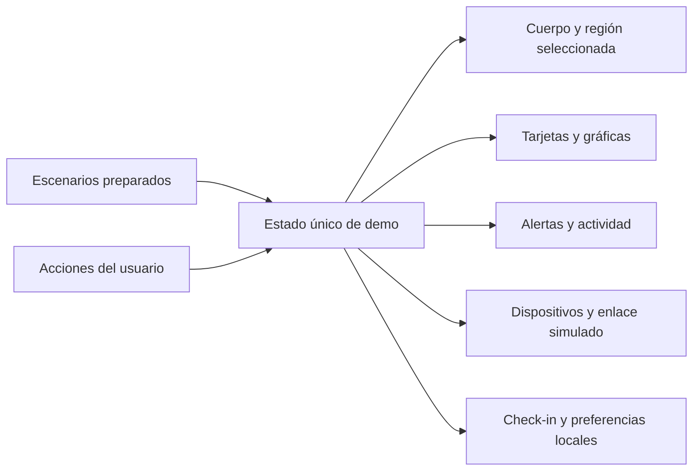

# SIMISA — Tecnología y arquitectura del prototipo

Fecha de consulta de documentación: 14 de noviembre de 2026. Son recomendaciones para esta muestra, no decisiones técnicas ya ejecutadas.

## 1. Recomendación principal

Usar **React + Vite + Motion**, con ilustraciones en capas, zonas interactivas SVG y una simulación local de estados preparados. Añadir **Recharts** para las gráficas si el equipo puede integrarlo rápidamente.

React es la biblioteca de interfaz; Vite prepara y empaqueta la aplicación; Motion gestiona las transiciones. Esta combinación es suficiente para una aplicación de una sola página con datos ficticios y sin servicios de servidor propios. React documenta Vite como una opción para construir una aplicación desde cero, señalando que el equipo debe resolver las funciones adicionales que necesite. Aquí el alcance acotado reduce esa carga. [React: construcción desde cero](https://react.dev/learn/build-a-react-app-from-scratch), [Vite: guía](https://vite.dev/guide/).

No cambiaría la base React + Vite del plan anterior. La mejora principal es agregar animación explícita y simplificar el monitoreo a un escenario reproducible.

## 2. Selección de herramientas

| Necesidad | Elección propuesta | Motivo para este proyecto |
| --- | --- | --- |
| Interfaz | React | Componentes reutilizables para indicadores, paneles y regiones |
| Preparación y empaquetado | Vite | Aplicación local sencilla y salida estática para publicar |
| Lenguaje | TypeScript si ya lo conocen; JavaScript si acelera al equipo | Tipos compartidos ayudan a integrar; aprenderlos durante el evento puede retrasar |
| Animación de navegación | Motion, paquete `motion` | Acercamientos, transiciones y entrada/salida ligados al estado de React |
| Estilos | CSS Modules y variables CSS | Control directo del diseño y pocos pasos de configuración |
| Alternativa de estilos | Tailwind, si ya es habitual en el equipo | Mantener una herramienta conocida puede ser más rápido |
| Gráficas | Recharts | Componentes de gráficas integrados con React |
| Estado | `useReducer` + Context | Suficiente para una única simulación pequeña |
| Anatomía | Ilustraciones con transparencia + SVG | Calidad visual sin desarrollar una escena 3D |
| Guardado | `localStorage` para check-in y preferencias de demo | Persistencia mínima de datos ficticios |
| Publicación | Alojamiento de archivos estáticos que el equipo ya conozca | Compartir la muestra mediante un enlace |

No introducir simultáneamente varias bibliotecas de estado, dos motores de animación o un kit visual completo si no existe una necesidad concreta.

Motion dispone de animación declarativa, SVG y transiciones de entrada/salida; su instalación actual usa `npm install motion` e importaciones desde `motion/react`. [Motion para React](https://motion.dev/docs/react).

Recharts es una biblioteca de gráficas basada en componentes React y SVG. La recomendación de usarla aquí responde a la reutilización de la misma gráfica para pocos indicadores. [Recharts](https://recharts.github.io/en-US/).

## 3. Alternativas y cuándo elegirlas

| Alternativa | Cuándo tendría sentido | Decisión para esta muestra |
| --- | --- | --- |
| Svelte + Vite | Si el equipo ya domina Svelte; incluye mecanismos de transición | Alternativa válida; no aprenderlo solo por este prototipo |
| Next.js | Si ya existe una base de trabajo del equipo o se requieren sus funciones de aplicación | No incorporarlo por defecto para una demo local sin servidor |
| GSAP | Si alguien domina secuencias temporales complejas y puede mantenerlas | Alternativa a Motion para la escena; no sumar ambos sin necesidad |
| Three.js / React Three Fiber | Si hay un modelo anatómico listo, licencia resuelta y experiencia previa | Reservarlo como evolución; no es requisito para la sensación de recorrido |
| CSS sin biblioteca de animación | Si basta con pocos acercamientos y fundidos | Buen plan de simplificación si Motion demora la integración |
| Figma | Bocetar composición y presentar funciones futuras | Complemento; el recorrido principal se implementa en la app |

La documentación de Svelte describe transiciones reversibles; GSAP ofrece secuencias mediante timelines; Next.js incluye herramientas de navegación y funciones de servidor/cliente. La elección anterior es una valoración del alcance de SIMISA, no una clasificación universal de esos productos. [Svelte](https://svelte.dev/docs/svelte/transition), [GSAP](https://gsap.com/docs/v3/GSAP/Timeline/), [Next.js](https://nextjs.org/docs/app/getting-started).

## 4. Arquitectura mínima



El estado de navegación y el estado del episodio son independientes. Abrir corazón no reinicia la lectura respiratoria. Cerrar un panel no borra la alerta.

### Estructura sugerida para una implementación futura

```text
simisa-app/
  public/assets/anatomy/       cuerpo, corazón y pulmones
  src/app/                    estructura y navegación
  src/components/             tarjetas, botones y paneles
  src/features/body/          escena, regiones y encuadres
  src/features/health/        indicadores y detalle
  src/features/alerts/        aviso y registro de acciones
  src/features/check-in/      formulario breve
  src/features/devices/       fuentes y conexión
  src/demo/                   escenarios, eventos y estado
  src/content/                explicaciones y referencias
  src/styles/                 colores, tipografía y composición
```

Esta estructura todavía no está creada. No hace falta un archivo por cada renglón si un módulo pequeño puede mantenerse claro en menos archivos.

## 5. Contrato de datos compartido

Definir estas entidades antes de que cada persona desarrolle una vista por separado. Los nombres son una propuesta; lo importante es que todas las vistas usen el mismo significado.

| Entidad | Campos mínimos |
| --- | --- |
| Medición | `id`, `astronautId`, `metricId`, `value`, `unit`, `observedAt`, `sourceId`, `quality`, `captureMethod`, `isDemo` |
| Fuente | `id`, `label`, `connection`, `lastObservedAt` |
| Indicador | `id`, `label`, `regionId`, `unit`, `explanation`, `sourceRefs` |
| Episodio | `id`, `metricId`, `condition`, `acknowledgedAt`, `resolvedAt`, `evidenceIds`, `actions` |
| Navegación | `view`, `selectedRegion`, `selectedMetric`, `openPanel` |
| Escenario | `scenarioId`, `stepId`, `simulatedTime`, `isPaused` |
| Comunicación | `mode`, `oneWayDelayMinutes`, `messageStatus` |

- `value` puede ser `null` cuando no hay lectura actual; conservar por separado la última medición válida.
- `quality` puede ser válida, dudosa o inválida. No confundir calidad de señal con estado de conexión.
- `captureMethod` distingue sensor simulado e ingreso manual. `isDemo` identifica que ambos pertenecen a una muestra ficticia.
- Los tiempos deben provenir del reloj del escenario cuando representen eventos simulados. El reloj real de presentación, si aparece, debe estar rotulado por separado.
- `condition` y `acknowledgedAt` son independientes: un episodio puede seguir activo después de ser reconocido.
- La selección anatómica dirige a los indicadores asociados; no genera un diagnóstico del órgano.

## 6. Simulación recomendada

Preparar series cortas y eventos explícitos. Para esta muestra no hace falta producir ruido aleatorio cada segundo ni implementar un motor general para 14 variables.

Eventos sugeridos: `START_SCENARIO`, `ADVANCE_STEP`, `SELECT_REGION`, `ACKNOWLEDGE_ALERT`, `RECORD_ACTION`, `DISCONNECT_SOURCE`, `RECONNECT_SOURCE` y `RESET_DEMO`.

### Reglas de coherencia

1. Cada evento actualiza el estado una sola vez; las vistas derivan su contenido de ese estado.
2. El mismo valor y momento deben aparecer en tarjeta, gráfica y evidencia de alerta.
3. Cambiar el estado de un sensor no fabrica una nueva lectura normal.
4. Reconectar requiere una lectura nueva antes de marcar el indicador como actual.
5. Reconocer una alerta no modifica las mediciones.
6. Una acción registrada no demuestra que el usuario haya realizado una intervención real.
7. La recuperación se representa con datos posteriores preparados, no como una garantía de efecto de la acción elegida.
8. Reiniciar limpia episodios, selección y temporizadores del escenario. El borrado del check-in se controla por separado y se explica.

Si se ilustra persistencia, incluir una secuencia de lecturas y su duración simulada. Un botón Advance puede adelantar el reloj; mostrar Time advanced in demo. No describir el tiempo elegido para el guion como un criterio clínico validado.

Para una reproducción automática opcional, usar un único reloj con pausa y reinicio. Evitar un temporizador independiente en cada tarjeta. Al cambiar de pestaña o pausar, no acumular pasos que se disparen juntos al regresar.

## 7. Cómo implementar el recorrido corporal

### Espacio de coordenadas común

La imagen del cuerpo, las zonas interactivas y los puntos de anclaje deben compartir un mismo sistema de coordenadas. Una opción es un SVG con `viewBox` ajustado al recurso anatómico, con la imagen y las zonas dentro del mismo grupo transformado.

Cada región define su identificador, nombre, zona seleccionable, centro de encuadre y escala de acercamiento. Calibrar estas posiciones sobre la ilustración definitiva; no copiar coordenadas de una captura diferente.

### Escena persistente

Mantener montado el cuerpo al cambiar de región. Animar su posición y escala hacia el destino seleccionado, mientras la ilustración detallada y el panel cambian de transparencia. Si cada selección desmonta toda la escena, es más difícil conservar continuidad.

El punto de ampliación depende de la región y del tamaño del área visible. Preparar encuadres para laptop y tablet; no usar desplazamientos fijos que solo encajen en una resolución.

### Capas de detalle

Al ampliar el pecho, superponer la ilustración detallada del corazón o de los pulmones con anclaje coherente. Precargar las tres imágenes antes de iniciar el recorrido. Si una falla, mantener un esquema simple y la lista de regiones disponibles.

### Estado y accesibilidad

Una única selección activa decide encuadre, título y contenido. Las entradas rápidas deben sustituir el destino anterior, no formar una cola. Aplicar las preferencias de movimiento reducido tanto a las animaciones de navegación como a los efectos CSS. [Motion: movimiento reducido](https://motion.dev/docs/react-accessibility).

## 8. Gráficas y conservación de datos

- Preferir una gráfica por indicador seleccionado, con unidad y período visibles.
- Dibujar huecos cuando falten datos; no interpolar a través de una desconexión.
- No rellenar una ausencia con cero.
- Mostrar una banda de referencia solo si su procedencia y significado están definidos para la demo.
- Guardar pocas muestras preparadas. No construir un almacenamiento de telemetría de larga duración.
- Usar el mismo rango temporal durante una transición para que el usuario pueda comparar.

## 9. Comunicación y funcionamiento local

La demora de propagación y la falta de enlace son situaciones distintas:

| Estado simulado | Representación |
| --- | --- |
| Sin enlace | Mensaje local pendiente de transmisión |
| Enlace disponible con demora | Mensaje transmitido, en tránsito |
| Recepción simulada | Llegada a Tierra representada al avanzar el escenario |

Una demora de 20 minutos por trayecto no exige que el mensaje espere 20 minutos antes de salir. Tampoco permite mostrar una respuesta médica automática al cumplirse esos 20 minutos.

La demo debe evitar dependencias de APIs remotas durante el recorrido. Empaquetar imágenes y fuentes utilizadas. Esto reduce puntos de fallo, pero no garantiza que una web publicada pueda recargarse sin internet.

Alcance P0: funcionamiento con datos locales mientras la aplicación y sus recursos están cargados, y copia de respaldo servida localmente en la computadora de presentación. P1: caché de aplicación que permita recarga sin conexión, probada de forma explícita. `localStorage` conserva datos, no los archivos necesarios para cargar la web.

## 10. Inicio sugerido, cuando comience la implementación

Comprobar la versión de Node requerida por la versión de Vite elegida. Crear el proyecto en una subcarpeta nueva para conservar los documentos originales.

```sh
npm create vite@latest simisa-app -- --template react-ts
cd simisa-app
npm install
npm install motion recharts
npm run dev
```

Si el equipo elige JavaScript, usar la plantilla `react`. Estos comandos están documentados como propuesta; no se ejecutaron al preparar este plan. Las versiones y dependencias compatibles se fijarán con el archivo de bloqueo de la implementación. No actualizar paquetes durante las últimas horas sin una necesidad concreta.

Para preparar una entrega estática, utilizar el proceso de build documentado por Vite y probar los archivos resultantes con un servidor apropiado. No asumir que abrir directamente un archivo HTML desde el explorador reproduce la aplicación. [Vite: publicación estática](https://vite.dev/guide/static-deploy.html).

## 11. Verificación técnica proporcional

Primero ejecutar los recorridos manuales de [05 — Demo y validación](05-demo-y-validacion.md). Si se automatiza algo, priorizar transiciones del escenario: reconocer sin resolver, pérdida de datos, reconexión y reinicio. Esas pruebas detectan incoherencias más importantes que comprobar cada clase de estilo.

Validar además que el build termina, los recursos cargan desde la publicación y no aparecen errores durante la historia principal. La meta de fluidez se evalúa en la computadora real de presentación; no prometer una tasa de cuadros sin medirla.
