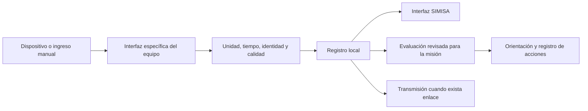

# SIMISA — Integración futura, referencias NASA y fuentes

Fecha de revisión: 14 de noviembre de 2026.

## 1. Tres niveles que deben distinguirse en la presentación

| Nivel | Qué puede mostrar el equipo | Qué evidencia faltaría para avanzar |
| --- | --- | --- |
| Prototipo de experiencia | Navegación, gráficos, datos ficticios y acciones simuladas | Pruebas de que el recorrido funciona y se entiende |
| Integración prevista | Arquitectura conceptual para recibir y presentar mediciones | Interfaz del fabricante, equipos, pruebas de interoperabilidad y calidad |
| Aplicación evaluada para una misión | Requisitos aplicables, trazabilidad y resultados de verificación | Revisión clínica, ingeniería, seguridad, factores humanos y aceptación del programa correspondiente |

El estado actual es documentación de un prototipo. No hay integración real ni conformidad demostrada. Explicar el camino hacia esos niveles aporta credibilidad sin prometer capacidades todavía inexistentes.

## 2. Cómo se integrarían dispositivos médicos

Arquitectura conceptual:

En la muestra, un proveedor de datos ficticios ocupa el lugar del dispositivo y su adaptador. Mantener una separación conceptual entre datos e interfaz facilita una futura sustitución; no demuestra que conectar cualquier equipo sea inmediato.

### Posibles fuentes

| Tipo | Uso conceptual | Pendiente antes de una integración real |
| --- | --- | --- |
| Monitor fisiológico vestible | Recibir señales o indicadores compatibles con el equipo | Variables disponibles, precisión, acceso a datos y condiciones de uso |
| Pulsioxímetro | SpO₂ y, según el equipo, frecuencia cardíaca | Calidad de señal, limitaciones del dispositivo y formato de salida |
| Tensiómetro | Mediciones puntuales con fecha y contexto | Método, procedimiento de medición e importación |
| Dispositivo de seguimiento del sueño | Resúmenes y tendencias | Qué mide directamente, qué estima y cómo se valida |
| Check-in manual | Sueño declarado, ánimo, estrés y síntomas futuros | Privacidad, significado de las escalas y revisión del flujo |

Bio-Monitor es un antecedente real de tecnología vestible para registrar signos vitales en la ISS. Esto respalda la plausibilidad general de la idea, no certifica todos los dispositivos enumerados en el plan anterior ni ofrece automáticamente una integración disponible. [Agencia Espacial Canadiense: Bio-Monitor](https://www.csa-asc.gc.ca/eng/sciences/bio-monitor.asp).

### Información que conviene conservar junto a una medición

Identidad del astronauta, tipo de indicador, valor, unidad, momento de adquisición, dispositivo de origen, calidad, método de captura y estado de simulación. En una integración real podrían requerirse además versión del dispositivo, calibración, momento de recepción y contexto de actividad; la selección final depende del equipo y la misión.

No asumir que temperatura de piel, temperatura central estimada y temperatura corporal medida son intercambiables. No presentar índices óseos, densidad ósea y otros resultados como si fueran la misma variable. Cada dato necesita una definición y un método.

## 3. Qué significa usar recursos de NASA

NASA identifica cinco peligros principales: radiación, aislamiento y confinamiento, distancia de la Tierra, campos gravitatorios y ambientes cerrados u hostiles. Este marco sirve para elegir problemas y explicar el contexto de SIMISA. [NASA HRP: cinco peligros](https://www.nasa.gov/hrp/hazards/).

Aplicación propuesta:

| Recurso o tema | Uso visible en SIMISA |
| --- | --- |
| Distancia de la Tierra | Escenario de demora y orientación local |
| Aislamiento y confinamiento | Explicación del propósito del check-in de bienestar |
| Gravedad | Contenido futuro sobre adaptación y seguimiento de rutinas |
| Ambiente cerrado | Explicación contextual de la misión, sin atribuir causas a una lectura aislada |
| Radiación | Referencia dentro de la visión futura, sin construir una alerta de tormenta solar en P0 |

Los recursos deben influir en decisiones de diseño o contenido, y esa relación debe ser visible. No basta con agregar un logo o una lista de enlaces.

Los datos ficticios de la demo no son datos de astronautas de NASA. Describirlos como datos sintéticos creados para representar el escenario.

## 4. Demora de comunicación

NASA describe demoras por trayecto que dependen del perfil de misión y pueden llegar aproximadamente a 21–23 minutos. Proponer 20 minutos en SIMISA es una elección del escenario, no una constante para cualquier ubicación o momento. [NASA: Mars Communications Disruption and Delay](https://www.nasa.gov/wp-content/uploads/2024/01/mars-communications-disruption-and-delay.pdf?emrc=1adf04).

Con 20 minutos por trayecto, una ida y vuelta implica al menos 40 minutos de propagación, sin contar revisión, disponibilidad o interrupciones. La demo debe distinguir un mensaje pendiente por falta de enlace de un mensaje ya transmitido y en tránsito.

## 5. Referencias de estándares de NASA

Las páginas oficiales identifican **NASA-STD-3001 Volume 1: Crew Health** y **Volume 2: Human Factors, Habitability, and Environmental Health**. El índice del volumen 2 incluye una sección de interfaces de tripulación. Son referencias pertinentes para estudiar el futuro producto; no se verificaron en este trabajo cláusulas individuales ni la conformidad del diseño. [Volumen 1](https://www.nasa.gov/reference/nasa-std-3001v1/), [Volumen 2](https://www.nasa.gov/reference/nasa-std-3001v2/).

Antes de citar una exigencia normativa, el equipo debe confirmar documento, revisión, sección, identificador y aplicabilidad a su caso. Las páginas de presentación no sustituyen el texto normativo vigente.

### Matriz inicial de investigación — no es una matriz de cumplimiento

Los identificadores siguientes son internos de SIMISA, no números de requisitos NASA.

| ID interno | Referencia a investigar | Decisión de diseño candidata | Evidencia futura | Estado |
| --- | --- | --- | --- | --- |
| INV-01 | NASA-STD-3001 Vol. 1, salud de tripulación | Explicaciones y orientación revisadas por personal competente | Registro de revisión y validación pertinente | Pendiente de identificar cláusula aplicable |
| INV-02 | NASA-STD-3001 Vol. 2, interfaces de tripulación | Lectura rápida, unidades visibles y controles consistentes | Prueba de tareas y trazabilidad del requisito | Pendiente |
| INV-03 | NASA-STD-3001 Vol. 2, interfaces y factores humanos | Diferenciar dato ausente, alerta y reconocimiento | Ensayo de escenarios y evaluación humana | Pendiente |
| INV-04 | NASA-STD-3001 Vol. 2, desempeño y error humano | Navegación predecible y retorno al panorama | Pruebas con usuarios representativos | Pendiente |
| INV-05 | Requisitos del programa y misión que se definan | Captura, calidad, almacenamiento y comunicación | Especificación de integración y resultados de pruebas | Pendiente de definir misión y alcance |

Estos candidatos son propuestas del equipo de planificación. No se afirma que una cláusula específica exija exactamente la implementación sugerida.

### Cómo completar la trazabilidad más adelante

1. Obtener la revisión oficial que corresponda al proyecto y registrar su fecha.
2. Identificar requisitos aplicables con apoyo especializado.
3. Relacionar cada requisito con una función, decisión de diseño o procedimiento.
4. Definir el método de verificación: inspección, análisis, demostración o prueba, según corresponda.
5. Guardar evidencia, resultados, responsable y limitaciones.
6. Revisar las brechas; no convertir la ausencia de una prueba en una afirmación de cumplimiento.

Formulación defendible para la muestra: “SIMISA contempla una futura evaluación frente a los requisitos aplicables de NASA-STD-3001. Este prototipo explora la experiencia de usuario; no demuestra conformidad”.

## 6. Contenido clínico de la demo

El plan anterior reúne rangos y recomendaciones de distinta procedencia. No reutilizarlos como un protocolo espacial general. Para esta muestra, seleccionar pocos mensajes, identificar su fuente y revisarlos con la médica del equipo si esa persona está disponible.

NEWS2 se desarrolló para la evaluación de enfermedad aguda en el contexto descrito por el Royal College of Physicians. Su mención no valida la adaptación de umbrales a este prototipo espacial. [RCP: resumen de NEWS2](https://www.rcp.ac.uk/media/ctulqqbn/news2-executive-summary_0.pdf).

Los textos de acción que se preparen deben distinguir orientación de medición, consulta a un responsable y tratamientos. No generar instrucciones de oxígeno, medicación o dosificación a partir del guion de demo. El uso del término protocolo requiere identificar cuál es y quién lo revisó.

El ejemplo de SpO₂ representa una lectura ficticia que merece atención dentro del escenario. No permite atribuir una causa, diagnosticar una enfermedad ni demostrar que una intervención fue efectiva.

## 7. Entrega del evento: verificado y pendiente

| Punto | Estado de la comprobación |
| --- | --- |
| Fecha general de cierre: 15 de noviembre de 2026, 23:59 hora local | Corroborada en el contenido indexado del sitio oficial; confirmar horario de juzgamiento local |
| 7 slides o video de hasta 30 segundos; contenido en inglés | Mencionado en una respuesta pública del espacio de consultas del evento; pendiente de contraste con la guía completa |
| Uso y declaración de IA, reglas específicas de imágenes, material previo y otros detalles | Revisar en la guía vigente; no asumir todas las afirmaciones del plan anterior |
| Recurso NASA elegible para premios globales | Confirmar el recurso concreto en la pestaña Resources del challenge y documentar su uso |

Fuentes de entrega: [sitio oficial 2026](https://www.spaceappschallenge.org/2026/), [consulta pública sobre entrega](https://github.com/nasa/spaceapps/discussions/1973), [Project Submission Guide](https://www.spaceappschallenge.org/resources/project-submission-guide/), [consulta sobre recursos](https://github.com/nasa/spaceapps/discussions/1827).

La guía completa no pudo recuperarse durante esta revisión. La página específica del challenge tampoco se recuperó en la revisión inicial; el análisis funcional se basa en el resumen local proporcionado. Estos límites no impiden diseñar la experiencia, pero las reglas de entrega se deben confirmar antes de presentar.

La ventana de trabajo del equipo sigue siendo de 30 horas. No extenderla por suponer que el cierre general coincide con la presentación local.

## 8. Registro de fuentes y recursos que acompañará la implementación

Para cada texto, imagen, conjunto de datos o componente externo, registrar:

- Título, autor u organización y enlace de origen.
- Fecha de consulta y revisión o versión cuando corresponda.
- Uso concreto dentro de SIMISA.
- Licencia o condiciones de uso que se hayan comprobado.
- Cambios realizados, generación con IA si la hubiera y revisión pendiente.

Las fuentes tecnológicas están enlazadas junto a las recomendaciones del documento 03. Los tiempos de animación, colores, alcance y guiones de este paquete son propuestas originales de diseño; no deben presentarse como exigencias de NASA.

## 9. Ruta posterior al hackatón

1. Probar la navegación con usuarios y revisar si la anatomía ayuda a comprender.
2. Definir un caso de uso y un equipo de medición real.
3. Validar adquisición, unidades, calidad, errores y datos faltantes.
4. Revisar orientación y criterios clínicos con profesionales pertinentes.
5. Desarrollar privacidad, permisos, registro de actividad y almacenamiento adecuados al uso previsto.
6. Identificar requisitos de misión y preparar la trazabilidad correspondiente.
7. Evaluar el sistema completo con evidencia, sin extrapolar resultados de esta demo.
